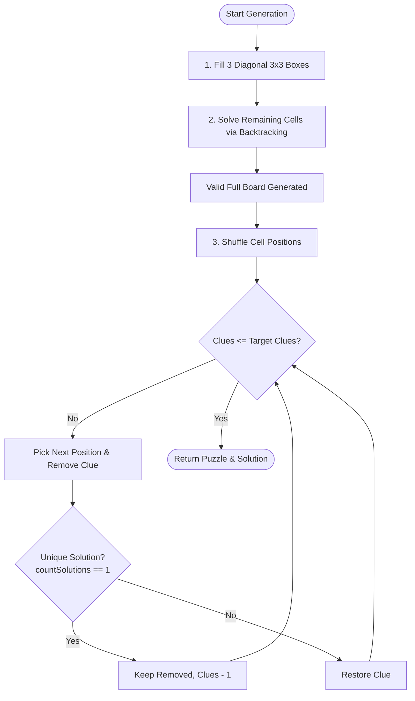

# Sudoku 9x9 Offline: Technical Learning Guide

Welcome to the **Sudoku 9x9** architecture and learning documentation! This guide breaks down the core computer science principles, mathematical algorithms, and web engineering practices used to build a 100% offline-ready, responsive Sudoku web application.

---

## 1. Project Summary
This application is a modern, standalone 9x9 Sudoku game engineered for both desktop and mobile devices. It requires zero network connectivity to operate once loaded, supports medium difficulty puzzle generation with guaranteed unique solutions, and includes standard player conveniences such as pencil candidate notes, real-time conflict checking, move history (undo), automated timer, and dark/light themes.

---

## 2. Technology Stack ("The Why")

### Pure Vanilla Stack (HTML5, CSS3, ES6+ JavaScript)
- **Why no heavy frameworks (e.g. React/Vue/Angular)?**
  - **Zero Build Step & Instant Run**: Works straight out of the box in any browser by opening `index.html`.
  - **Zero Network Overhead**: No CDN downloads or bundled node dependencies to fetch. This guarantees instant load times and reliable offline operation.
  - **Minimal Memory Footprint**: Crucial on low-power mobile devices and battery-constrained scenarios.

### Progressive Web App (PWA) & Service Worker
- **Why a Service Worker (`sw.js`)?**
  - Intercepts network requests and implements a **Cache-First** strategy. All essential assets (`index.html`, `style.css`, `app.js`, `sudoku-engine.js`, `manifest.webmanifest`, `icons/icon.svg`) are stored locally in the browser's Cache Storage.
  - Enables true airplane-mode offline capability and can be added directly to mobile home screens ("Add to Home Screen").

### Web Storage API (`localStorage`)
- Saves the player's active board state, timer progress, candidate notes, and theme preference so that page reloads or app closures never cause data loss.

---

## 3. Technical Logic ("The How")

### A. The Sudoku Generation Algorithm
A naive random generator is prone to creating unsolvable or ambiguous boards. To construct a legitimate Sudoku puzzle, we use a multi-step backtracking pipeline:



#### Step 1: Diagonal Block Optimization
The three 3x3 blocks along the main diagonal (top-left, center, bottom-right) are completely independent of each other—none of them share a row or column. We can fill these 3 blocks with independent random permutations of numbers 1–9 with **zero conflict checks**. This drastically reduces the search tree for the subsequent backtracking step.

#### Step 2: Randomized Recursive Backtracking
We fill the remaining 6 blocks using depth-first recursive backtracking:
1. Find an empty cell.
2. Randomly shuffle candidates `[1..9]`.
3. For each candidate, check if it obeys Sudoku rules (unique in row, column, and 3x3 box).
4. If valid, place the candidate and recursively attempt to solve the rest of the board.
5. If recursion hits a dead-end, backtrack by resetting the cell to `0` and trying the next candidate.

#### Step 3: Clue Removal with Uniqueness Verification
A proper Sudoku puzzle **must have exactly one unique solution**.
- We iterate through cell coordinates in random order.
- We temporarily remove the number from the cell.
- We run a specialized solver function `countSolutions(board, limit=2)`. If `countSolutions` finds 2 solutions, it halts immediately (early exit optimization).
- If the count remains `1`, the removal is preserved. If it exceeds 1, we restore the number.
- For **Medium Difficulty**, we stop removing clues when the remaining clue count reaches **~32 to 35**.

---

### B. Conflict Detection
To give immediate feedback to the player, `findConflicts(grid)` checks:
1. Each of the 9 rows for duplicates.
2. Each of the 9 columns for duplicates.
3. Each of the nine 3x3 sub-boxes for duplicates.

Any cell that participates in a duplicate entry is marked with a `.conflict` class, alerting the player visually without revealing the hidden solution.

---

### C. Pencil Notes & Pruning
Sudoku players use pencil marks (candidate numbers) to track possibilities.
- Each cell contains an internal 3x3 subgrid representing digits 1 through 9.
- In **Notes Mode**, selecting a digit toggles its presence in that cell's candidate set.
- When the player places a verified digit in normal mode, the engine automatically **prunes** that digit from all candidate sets in the same row, column, and 3x3 box, saving repetitive manual clean-up.

---

## 4. Engineering Best Practices Applied

1. **Separation of Concerns**:
   - `sudoku-engine.js`: Pure mathematical and algorithmic module. Has zero DOM manipulation and can run identically in Node.js or web environments.
   - `app.js`: User interaction, input listeners, timers, and view rendering.
   - `style.css`: All visual presentation, CSS variables, transitions, and media queries.
2. **Mobile-First & Touch Optimization**:
   - Minimum 44×44px touch targets for toolbar buttons and numpad keys.
   - Prevention of double-tap zoom via `touch-action: manipulation` and meta viewport.
   - Dynamic unit scaling using CSS `clamp()` and `min(100vw - 24px, 520px)` so the board scales cleanly from a 360px smartphone to an ultrawide desktop monitor.
3. **Immutability of History for Undo**:
   - Undo/redo actions store clean state deltas (`prevVal`, `prevNotes`), allowing lightweight state reversal without cloning full 81-cell matrices on every click.
4. **Resilient Offline Architecture**:
   - Cache manifest versioning (`sudoku-v1.0.0`) ensures seamless updates when assets change.
   - `localStorage` fallback handles graceful degradation if local storage quotas are reached.

---

## 5. How to Run & Deploy

### Local Execution
1. Open `index.html` directly in any web browser:
   ```bash
   open index.html
   ```
2. Or serve locally with any HTTP server (e.g. for PWA Service Worker testing):
   ```bash
   python3 -m http.server 8080
   ```

### Vercel Deployment
The repository is configured with `vercel.json` for optimal static caching and PWA service worker header handling:
- **Option 1 (One-click Web Deploy)**:
  Import repository `https://github.com/prafullmoredk-pm/sudoku2` directly in the Vercel Dashboard.
- **Option 2 (Vercel CLI)**:
  Run `npx vercel` or `npx vercel --prod` in the project directory.
